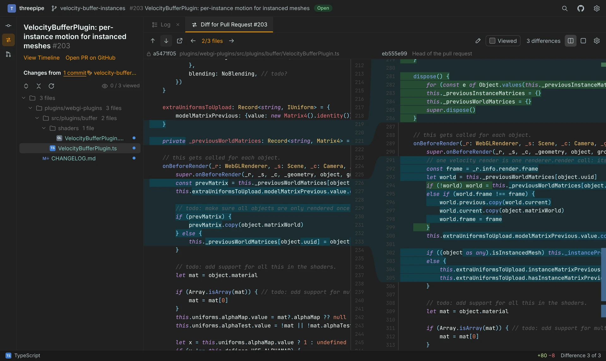
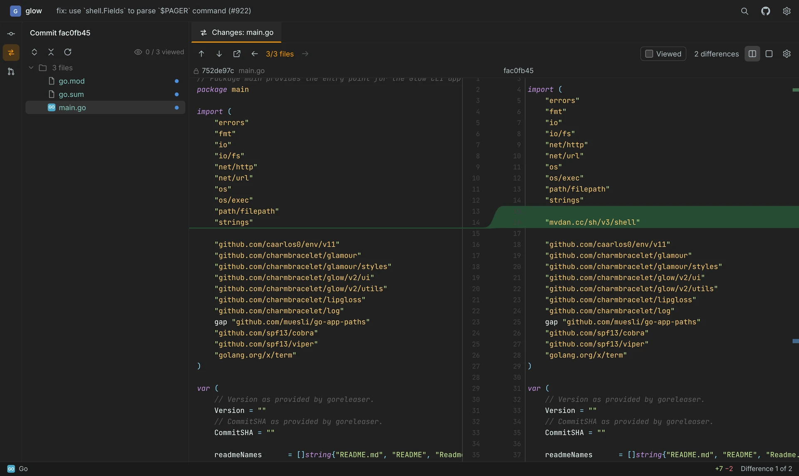
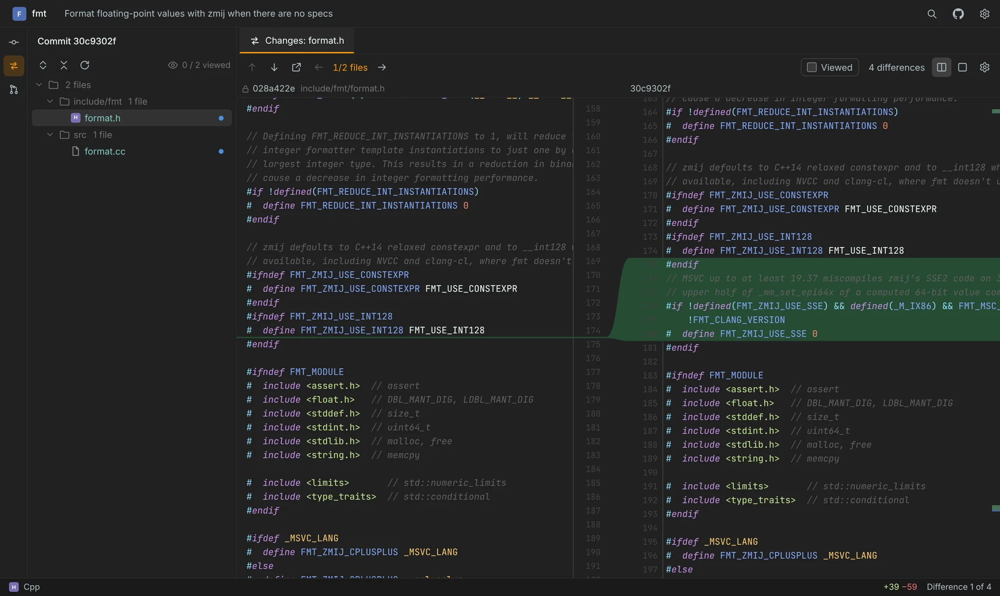
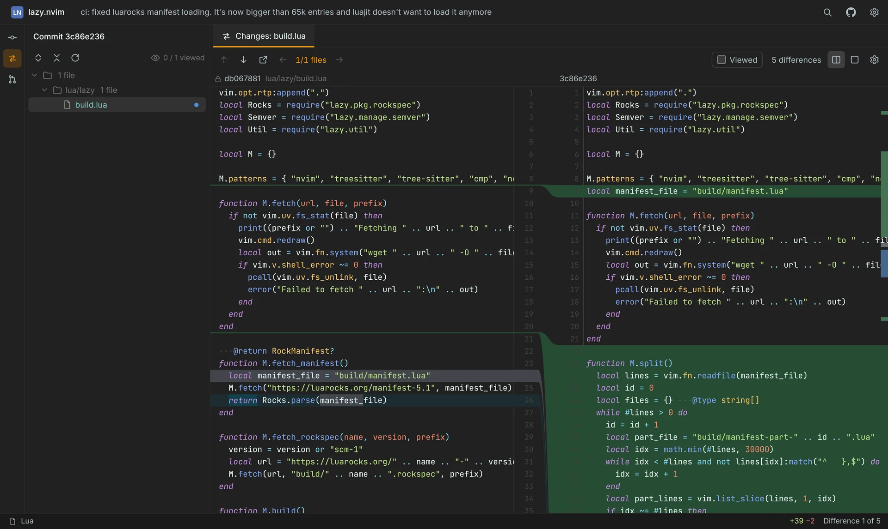
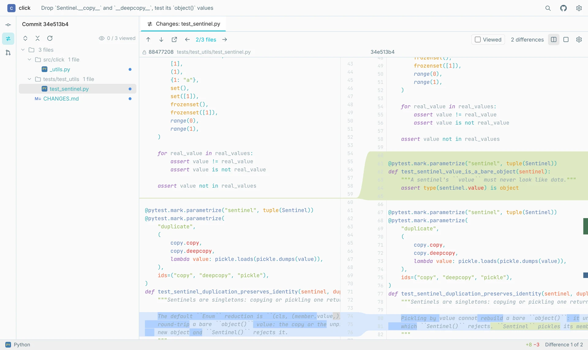

<p align="center"><picture><source media="(prefers-color-scheme: light)" srcset="icons/icon-light.svg"></picture></p>

<h1 align="center">jetdiff</h1>

<p align="center">Code changes in an IDE-style side-by-side diff, on any device, online or offline.</p>



jetdiff opens a GitHub pull request, a commit or a compare the way an IDE's diff shows it: a tree of the changed
files, and whole files side by side with curved connectors between the changes. It is a static web app with no
server of its own: it talks to the GitHub API from the browser, and loads everything else (its libraries and fonts
too) from the site itself. It runs in Chrome or Edge 89, Firefox 108, Safari 16.4 (iOS 16.4) or later; an older browser
gets a message saying so.

## Features

- **Side-by-side diff** of whole files, with connectors between matching changes, synced scrolling, word-level
  highlighting and line numbers of both sides in the gutter. A unified view is one click away (and the default on a
  phone).
- **Labels** for what a diff cannot show: a change of whitespace only, of the line endings (CRLF → LF) or of the
  byte-order mark, and Markdown changes the preview does not show (link targets, image sources, HTML attributes,
  reference definitions); files with edits made here and not pushed are labelled too.
- **Changed-files tree** grouped by directory, with Viewed checkboxes that sync with GitHub's own when signed in. As on
  GitHub, a file marked Viewed that changes afterwards (a new push) is not viewed any more.
- **Commits**: a log with a graph line; select a commit or a range to see only its changes.
- **Timeline**: the description, comments and reviews with their inline threads, rendered as Markdown, with the
  reactions to the description and the comments (counts only: GitHub's summary does not say who reacted).
- **Markdown preview** for `.md` files, with the changed words highlighted and the two versions kept side by side (a file
  over 3000 lines opens as code, as its preview takes seconds on a phone: Preview shows it).
- **Quick edits**: edit the PR's files in place and commit them to its branch, with Amend and Undo.
- **Search Everywhere** (double Shift) for files, actions, settings, commits and pull requests.
- **Go to Declaration** (⌘/Ctrl-click, ⌘B/Ctrl+B) in every language, and TypeScript's own declarations and hovers
  for TypeScript and JavaScript.
- **JetBrains keys** in the editors (or VS Code's), and comments in each language's own style.
- **Offline**: an installable app; download a repository's open pull requests and read them with no network.
- **Themes**: the Material Theme UI variants (Darker, Oceanic, Palenight, Lighter and more).

## Screenshots

| | |
| --- | --- |
|  Markdown preview |  Timeline |
|  GLSL (threepipe) |  TSX (shader-flow-editor) |
|  Rust ([fd](https://github.com/sharkdp/fd)) |  Go ([glow](https://github.com/charmbracelet/glow)) |
|  Python ([click](https://github.com/pallets/click)) |  C++ ([fmt](https://github.com/fmtlib/fmt)) |
|  Ruby ([Sinatra](https://github.com/sinatra/sinatra)) |  TypeScript ([VS Code](https://github.com/microsoft/vscode)) |
|  Lua ([lazy.nvim](https://github.com/folke/lazy.nvim)) |  Material Lighter theme |

<p align="center"></p>

## Use

Open `?pr=owner/repo/123`, or paste a pull request, commit or compare URL on the start page. Links keep their place:

| URL | Shows |
| --- | --- |
| `?pr=owner/repo/123` | a pull request |
| `?pr=owner/repo/123&file=src/a.ts` | a pull request, at a file |
| `?pr=owner/repo/123&commit=<sha>` | one commit of a pull request (`<sha1>..<sha2>` for a range) |
| `?pr=owner/repo/123&tabs=log,timeline&tab=timeline` | a pull request with the Log and Timeline tabs open, the Timeline in front |
| `?compare=owner/repo/main...feature` | a compare from where `feature` branched off `main`; with `..`, the two tips directly |
| `jetdiff.com/owner/repo/pull/123` | a GitHub link with `github.com` replaced: pull requests (also `…/files/<sha1>..<sha2>`), commits and compares |

The URL follows the open tabs in place (a reload, or a shared link, opens them again; Back does not step through
them): `tabs` lists the tabs open besides the diff when they are not the default, the Log alone (`tabs=` with none),
and `tab` names the one in front when it is not the diff.

GitHub lists at most 3000 files of a pull request or a commit, and 300 of a compare, and at most 250 commits of a pull
request (jetdiff reads the first 300 of a compare): a note over the diff says when a list is cut short, when the commits
or GitHub's Viewed marks could not be read, and when the merge base could not be read (the diff is then against the
base branch's tip); it stays until closed. The Log says so of a commit's or a range's files, and the Timeline when it
shows only part of the conversation (its first 500 comments) or could not read its inline comments or reactions.

A request that GitHub does not answer for 30 seconds is given up: the changes, a file or the Timeline that waited on
it says so, with Retry. Errors say in plain words what went wrong, with what GitHub said under them; a link that opens
nothing (a malformed `?pr=`, `?commit=` or `?compare=`, or a path that is no GitHub link) says why on the start page,
and a `file=` that is not among the changes says so over the first file.

### Keys

F7 and Shift+F7 (or the arrows over the diff) move between differences, as in IntelliJ's diff: the caret goes to the
start of the difference's first line, in the editor you are in (or the other side, when the difference has no lines
on yours), which takes the focus (not on a touch screen), and the difference shows in the middle of the view (a `»` by its line number in the
side-by-side view). A step goes on from the difference last stepped to, from the caret once you move it, or from the
middle of the view once you scroll. Past a file's last difference, a tip at the caret says *Press again to go to the
next file*: pressing again, with nothing else in between, opens the next file at its first difference (Shift+F7, the
previous file at its last); on the last file it says *No more differences*. ⌃⇧→ and ⌃⇧← move between files on a Mac
(Alt+Shift+→ and Alt+Shift+←, or Alt+→ and Alt+←, elsewhere, as in IntelliJ), V marks a file viewed, double Shift opens
Search Everywhere (⌘/Ctrl+Shift+A its actions, ⌘/Ctrl+P its files), and ⌘/Ctrl with + − 0 sizes the editor font.

The editors follow IntelliJ's keymap: its macOS keys on a Mac, its Windows/Linux keys elsewhere (the settings, the gear
in the title bar, switch to VS Code's keys). In the read-only sides the editing keys do nothing.

| Action | macOS | Windows/Linux |
| --- | --- | --- |
| Go to Declaration | ⌘B, ⌘-click | Ctrl+B, Ctrl+click |
| Back, Forward | ⌘[, ⌘] | Ctrl+Alt+←, Ctrl+Alt+→ |
| Duplicate Line or Selection | ⌘D | Ctrl+D |
| Delete Line | ⌘⌫ | Ctrl+Y |
| Move Line Up, Down | ⌥⇧↑, ⌥⇧↓ | Alt+Shift+↑, Alt+Shift+↓ (also Ctrl+Shift+↑, ↓) |
| Extend, Shrink Selection | ⌥↑, ⌥↓ | Ctrl+W, Ctrl+Shift+W |
| Add Next Occurrence, Unselect It | ⌃G, ⌃⇧G | Alt+J, Alt+Shift+J |
| Select All Occurrences | ⌃⌘G | Ctrl+Alt+Shift+J |
| Comment with Line Comment | ⌘/ | Ctrl+/ |
| Comment with Block Comment | ⌘⌥/ | Ctrl+Shift+/ |
| Find, Replace | ⌘F, ⌘R | Ctrl+F, Ctrl+R |
| Find Next, Previous | ⌘G, ⌘⇧G | F3, Shift+F3 |
| Go to Line | ⌘L | Ctrl+G |
| Undo, Redo | ⌘Z, ⌘⇧Z | Ctrl+Z, Ctrl+Shift+Z |
| Join Lines | ⌃⇧J | Ctrl+Shift+J |
| Split Line | ⌘↩ | Ctrl+Enter |
| Start New Line, Before | ⇧↩, ⌘⌥↩ | Shift+Enter, Ctrl+Alt+Enter |
| Rename in File (all occurrences) | ⇧F6 | Shift+F6 |
| Move Caret to Matching Brace | ⌃M | Ctrl+Shift+M |
| Quick Documentation (TypeScript, JavaScript) | ⌃J, F1, or a pause on a name | Ctrl+Q, or a pause on a name |

With VS Code's keys, Go to Declaration is F12 or ⌘/Ctrl-click.

Go to Declaration in TypeScript and JavaScript asks TypeScript's language service, fed with the file and the files it
imports by relative paths (read from the repository at the same commit). Elsewhere, and when TypeScript finds nothing,
it looks for declarations of the name in the changed files, on both sides (`function x`, `class x`, `def x`, `fn x`, a
C type before `x(`…), and then with GitHub's code search in the repository, which needs GitHub access and allows about 10
searches a minute. One declaration opens; several are listed to choose from. A file outside the changes opens on its
own, read-only, with a link to it on GitHub; Back returns.

### Links from AI agents

To let an agent (Claude Code, Codex and others) link pull requests through jetdiff where that helps, add this line to
its instructions file (`CLAUDE.md`, `AGENTS.md`); the start page has it with a Copy button:

> When it helps the reader, link GitHub pull requests, commits and compares through jetdiff instead: the same URL with
> `github.com` replaced by `jetdiff.com` (for example https://jetdiff.com/owner/repo/pull/123), which opens it in an
> IDE-style diff.

### GitHub access

Public repositories work without signing in (GitHub allows 60 requests an hour then; when they run out, a message
offers to sign in). For private repositories, a
higher limit and commits, either **Sign in with GitHub** (on jetdiff.com: it sees the repositories where the jetdiff
app is installed, and its token renews itself), or paste a token in the settings (the gear in the title bar): a fine-grained token with *Contents:
read* and *Pull requests: read and write* (write is only for Viewed), and *Contents: read and write* to commit edits;
or a classic token with `repo`. The token stays in the browser's storage and is sent only to `api.github.com` (a
token from Sign in with GitHub goes to this site once more, at sign-out, which revokes it at GitHub). Sign out and
Remove token ask first, and can also remove the data saved on this device (saved pull requests, recents, Viewed marks,
commit options; not the settings) and, separately, the edits not pushed yet.

### Edits

The pencil over the diff makes the right side (the pull request's head) editable; Commit and Push commits the edits
to the pull request's branch, with Amend and Undo. Amend keeps the amended commit's author and date, as `git commit
--amend` does; its committer is the one set in Commit Options, else the author set there, else the token's account.
Edits are kept on the device until committed; an edited file has a dot in the tree and "edited here" over its diff. A file that is not valid UTF-8, or has both CRLF and LF line endings,
opens read-only (its label says why), as an edit would change the rest of the file too. When the pull request gets
new commits that change an edited file, the edit is kept aside, not applied: the Commit panel lists it to copy,
download or discard.

### Offline

Once loaded, the app opens with no network, and every pull request opened before shows from the saved copy. To get a
whole repository ready, use *Download for offline* (settings → Offline): it saves each open pull request with its
commits, file contents and conversation. Only the pull requests saved whole are listed as available offline: a full
storage stops the download and says so. Edits and Viewed marks made offline stay on the device. Saved data belongs
to the address the app was opened from.

A new version of the app downloads in the background, all of its files together; an open page keeps the version it
started with until it reloads, and says *jetdiff updated · Reload* once the new one is ready.

### Snapshots and offline packs

A snapshot is a set of recorded GitHub responses, for trying the app without a token or sharing a read-only copy.
Locally, recorded data opens from offline packs (.zip): record every open pull request of some repositories, make
packs of them, and import those on the page (drop them on it, or *Import offline pack* on the start page or in the
Offline dialog):

```sh
npm start
npm run record -- http://localhost:3000/ --repos owner/a,owner/b demo     # into snap/demo/
npm run pack -- snap/demo packs/                                          # packs/owner-a.zip, packs/owner-b.zip
```

A link opens recorded data from an https site that serves it: `?snap=https://…/demo/&pr=owner/repo/123` a snapshot
folder (one pull request is enough: `npm run record -- http://localhost:3000/ owner/repo/123 demo`), and
`?packs=https://…/packs/` the packs a folder lists in its `packs.json`, downloaded and imported. Other values are
ignored. A snapshot or a pack of a private repository contains its code.

While a snapshot shows, a bar at the top says where its data comes from; Exit there goes back to live GitHub. A
`?snap=https://…` or `?packs=https://…` link to another site asks first, as that data does not come from GitHub. Imported
packs are a fallback for when GitHub cannot be reached: online, everything comes from GitHub; with no network, the
pull requests a pack holds open from it, under the same bar.

## Develop

```sh
npm install
npm start        # http://localhost:3000/, on all interfaces
npm test         # Playwright, against a recorded pull request in tests/fixture
```

AGENTS.md describes the layout and the conventions. `npm start` and the tests run the site as jetdiff.com serves it:
`wrangler dev` runs the Worker and Cloudflare's static asset server locally (in workerd), on the build in `dist/`, which
it makes on start and again when a file of the site changes (`build` in `wrangler.jsonc`). There is no bundler: the
build copies the app's files as they are, and the libraries from `node_modules` to `vendor/<name>/<version>/`, a scope
as a folder (`vendor/fontsource/inter/5.3.0/`), as the asset server answers a path with an `@` with a redirect. The
service worker keeps the release it installed, so with `npm start` a change shows after the next reload brings the new
release in (or with *Update on reload* in the browser's developer tools). After changing a library's version, run
`npm run vendor`: it writes the versions into `index.html` (the import map and the font stylesheets) and the import
map's hash into the Content Security Policy (`worker/headers.js`); the build (and so `npm start`) refuses to run until
they match `node_modules`. Dependabot proposes updates weekly, of releases at least a week old
(`.github/dependabot.yml`), and `.github/workflows/vendor.yml` runs `npm run vendor` on its pull requests.
`js/themes.js` is generated from [Material Theme UI Lite](https://github.com/AtomMaterialUI/material-theme-ui-lite):

```sh
git clone --depth 1 https://github.com/AtomMaterialUI/material-theme-ui-lite /tmp/mtui
npm run themes -- /tmp/mtui
```

## Deploy

[jetdiff.com](https://jetdiff.com) is a Cloudflare Worker with static assets (`wrangler.jsonc`, `worker/index.js`):
`npm run build` copies the files the site serves into `dist/` (the libraries into `dist/vendor/`, about 700 files and
24 MiB in all, and `sw.js` with a release id: a hash of the app's files and its security headers), and `npm run deploy`
builds and deploys them with wrangler (a dev dependency, the one `npm start` runs). GitHub Actions deploys `main` after
the tests pass (`.github/workflows/ci.yml`), with the repository secrets `CLOUDFLARE_API_TOKEN` (an account token with
*Individual Workers Editor* on the jetdiff Worker only) and `CLOUDFLARE_ACCOUNT_ID`, and optionally `APP_CLIENT_SECRET`
to update the GitHub App's client secret. The domains are attached to the Worker in the Cloudflare dashboard, so the
token needs no zone or DNS rights. The Worker runs first on
each request for request logs, the `www` redirect and the security headers, with a Content Security Policy on the pages
(`worker/headers.js`), but for the libraries' (`vendor/`): those are static asset requests, which are not metered, and
get the same headers from `dist/_headers`.
Any static host works too: serve `dist/` after `npm run build`, with `404.html` for missing paths and, for the
policy, the headers of `worker/headers.js`.

Sign in with GitHub needs the Worker and a GitHub App (`worker/auth.js`): create the app with the callback URL
`https://<your domain>/auth/callback`, *Expire user authorization tokens* on, no webhook, and the repository
permissions *Contents: read and write*, *Pull requests: read and write* and *Metadata: read*. Its client ID and URL name
go in `wrangler.jsonc` (`GITHUB_CLIENT_ID`, `GITHUB_APP_SLUG`; jetdiff.com uses
[jetdiff-com](https://github.com/apps/jetdiff-com)), and its client secret in the Worker's secret `GITHUB_CLIENT_SECRET`.
Without them the site offers token pasting only.

## License

MIT, see LICENSE. The theme colors come from Material Theme UI Lite (MIT), and the JetBrains keymap from the IntelliJ
IDEA Keybindings extension for VS Code (MIT), see NOTICE.
