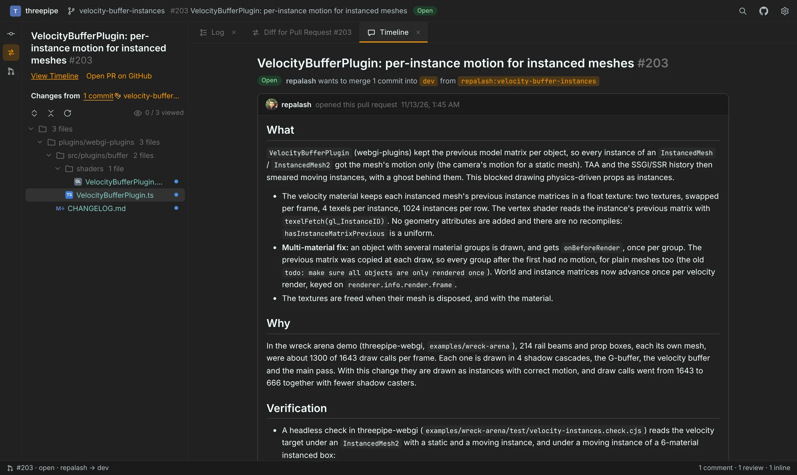
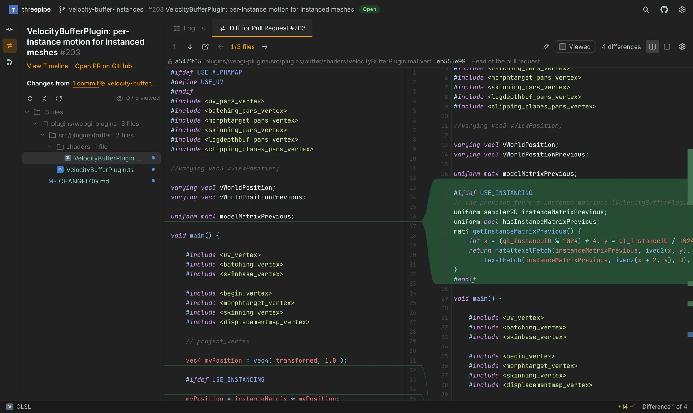
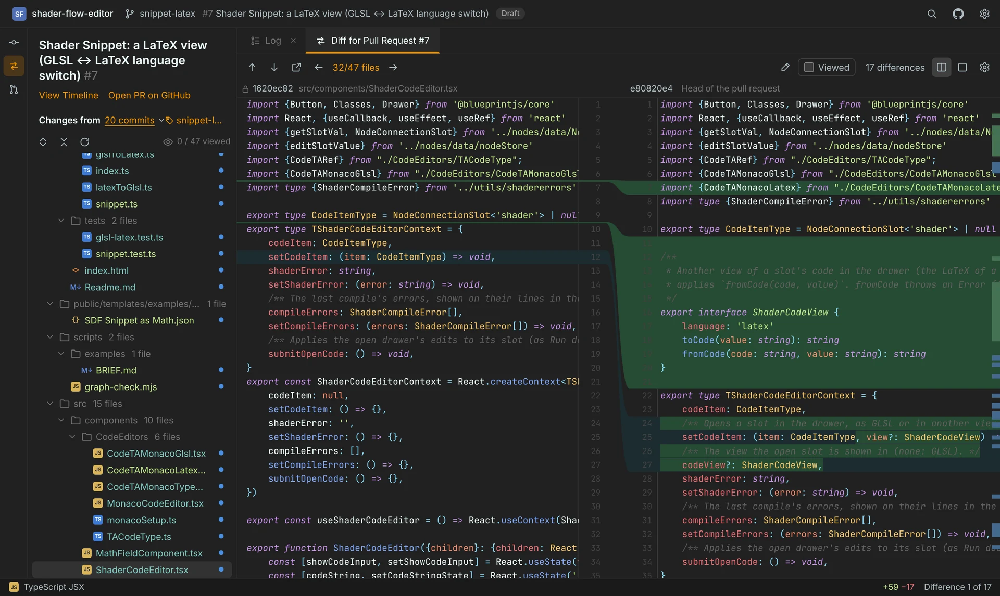
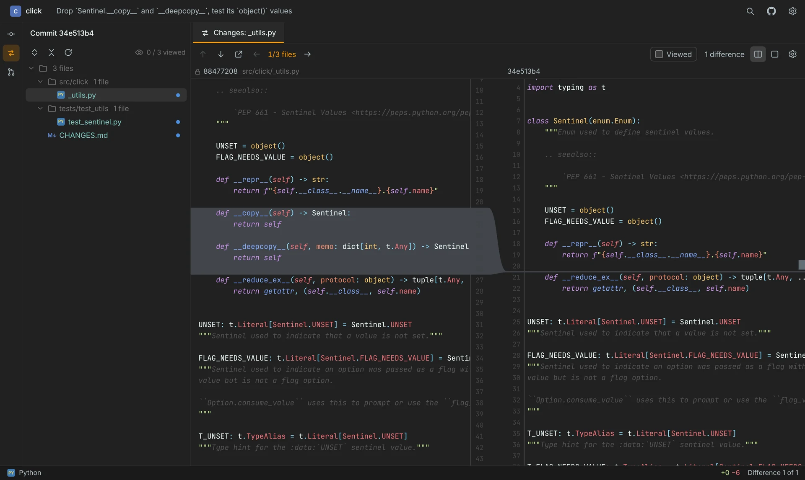
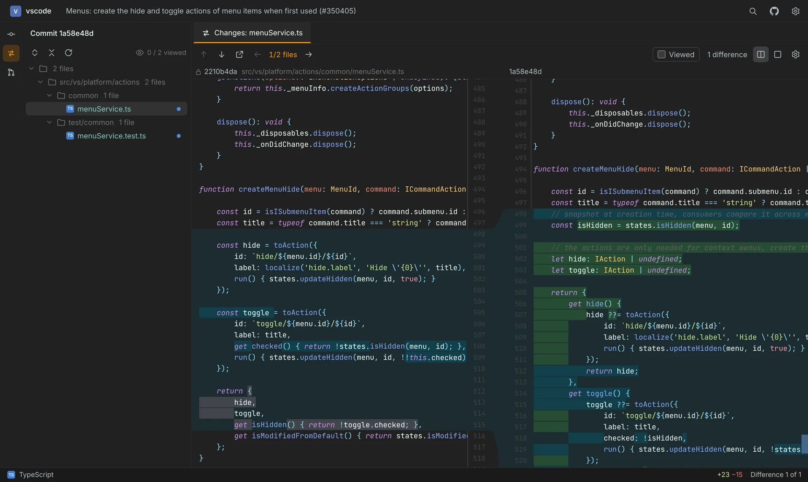
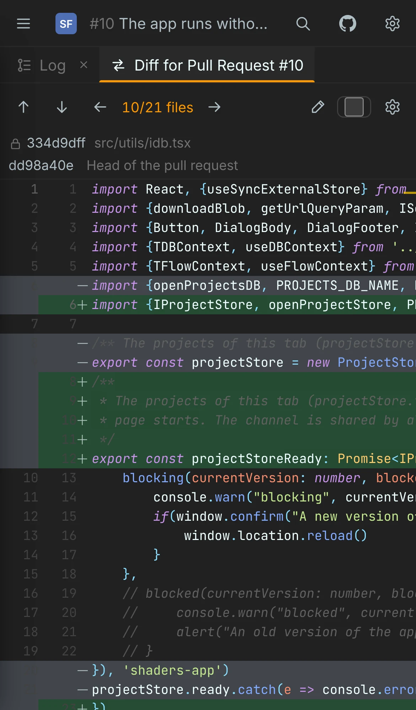

<p align="center"><picture><source media="(prefers-color-scheme: light)" srcset="icons/icon-light.svg"></picture></p>

<h1 align="center">jetdiff</h1>

<p align="center">Code changes in an IDE-style side-by-side diff, on any device, online or offline.</p>


jetdiff opens a GitHub pull request, a commit or a compare the way an IDE's diff shows it: a tree of the changed
files, and whole files side by side with curved connectors between the changes. It is a static web app with no
server of its own: it talks to the GitHub API from the browser, and loads everything else (its libraries and fonts
too) from the site itself.

## Features

- **Side-by-side diff** of whole files, with connectors between matching changes, synced scrolling, word-level
  highlighting and line numbers of both sides in the gutter. A unified view is one click away (and the default on a
  phone).
- **Changed-files tree** grouped by directory, with Viewed checkboxes that sync with GitHub's own when signed in.
- **Commits**: a log with a graph line; select a commit or a range to see only its changes.
- **Timeline**: the description, comments and reviews with their inline threads, rendered as Markdown.
- **Markdown preview** for `.md` files, with the changed words highlighted and the two versions kept side by side.
- **Quick edits**: edit the PR's files in place and commit them to its branch, with Amend and Undo.
- **Search Everywhere** (double Shift) for files, actions, settings, commits and pull requests.
- **Offline**: an installable app; download a repository's open pull requests and read them with no network.
- **Themes**: the Material Theme UI variants (Darker, Oceanic, Palenight, Lighter and more).

## Screenshots

| | |
| --- | --- |
|  Markdown preview |  Timeline |
|  GLSL (threepipe) |  TSX (shader-flow-editor) |
|  Rust ([fd](https://github.com/sharkdp/fd)) |  Go ([glow](https://github.com/charmbracelet/glow)) |
|  Python ([click](https://github.com/pallets/click)) |  C++ ([fmt](https://github.com/fmtlib/fmt)) |
|  Ruby ([Sinatra](https://github.com/sinatra/sinatra)) |  TypeScript ([VS Code](https://github.com/microsoft/vscode)) |
|  Lua ([lazy.nvim](https://github.com/folke/lazy.nvim)) |  Material Lighter theme |

<p align="center"></p>

## Use

Open `?pr=owner/repo/123`, or paste a pull request, commit or compare URL on the start page. Links keep their place:

| URL | Shows |
| --- | --- |
| `?pr=owner/repo/123` | a pull request |
| `?pr=owner/repo/123&file=src/a.ts` | a pull request, at a file |
| `?pr=owner/repo/123&commit=<sha>` | one commit of a pull request (`<sha1>..<sha2>` for a range) |
| `?compare=owner/repo/main...feature` | a compare from where `feature` branched off `main`; with `..`, the two tips directly |
| `jetdiff.com/owner/repo/pull/123` | a GitHub link with `github.com` replaced: pull requests (also `…/files/<sha1>..<sha2>`), commits and compares |

GitHub lists at most 3000 files of a pull request or a commit, and 300 of a compare: a notice says when a list is cut
short, and when the merge base could not be read (the diff is then against the base branch's tip).

Keys: F7 and Shift+F7 move between differences, Alt+→ and Alt+← between files, V marks a file viewed, double Shift
opens Search Everywhere, and Ctrl/⌘ with + − 0 sizes the editor font.

### Links from AI agents

To let an agent (Claude Code, Codex and others) link pull requests through jetdiff where that helps, add this line to
its instructions file (`CLAUDE.md`, `AGENTS.md`); the start page has it with a Copy button:

> When it helps the reader, link GitHub pull requests, commits and compares through jetdiff instead: the same URL with
> `github.com` replaced by `jetdiff.com` (for example https://jetdiff.com/owner/repo/pull/123), which opens it in an
> IDE-style diff.

### GitHub access

Public repositories work without signing in (GitHub allows 60 requests an hour then). For private repositories, a
higher limit and commits, either **Sign in with GitHub** (on jetdiff.com: it sees the repositories where the jetdiff
app is installed, and its token renews itself), or paste a token in the settings (the gear in the title bar): a fine-grained token with *Contents:
read* and *Pull requests: read and write* (write is only for Viewed), and *Contents: read and write* to commit edits;
or a classic token with `repo`. The token stays in the browser's storage and is sent only to `api.github.com` (a
token from Sign in with GitHub goes to this site once more, at sign-out, which revokes it at GitHub). Sign out and
Remove token ask first, and can also remove the data saved on this device (saved pull requests, recents, Viewed marks,
commit options; not the settings) and, separately, the edits not pushed yet.

### Edits

The pencil over the diff makes the right side (the pull request's head) editable; Commit and Push commits the edits
to the pull request's branch, with Amend and Undo. Amend keeps the amended commit's author and date, as `git commit
--amend` does; its committer is the one set in Commit Options, else the author set there, else the token's account.
Edits are kept on the device until committed. A file that is not valid UTF-8, or has both CRLF and LF line endings,
opens read-only (its label says why), as an edit would change the rest of the file too. When the pull request gets
new commits that change an edited file, the edit is kept aside, not applied: the Commit panel lists it to copy,
download or discard.

### Offline

Once loaded, the app opens with no network, and every pull request opened before shows from the saved copy. To get a
whole repository ready, use *Download for offline* (settings → Offline): it saves each open pull request with its
commits, file contents and conversation. Only the pull requests saved whole are listed as available offline: a full
storage stops the download and says so. Edits and Viewed marks made offline stay on the device. Saved data belongs
to the address the app was opened from.

A new version of the app downloads in the background, all of its files together; an open page keeps the version it
started with until it reloads, and says *jetdiff updated · Reload* once the new one is ready.

### Snapshots and offline packs

A snapshot is a set of recorded GitHub responses, for trying the app without a token or sharing a read-only copy:

```sh
npm start
npm run record -- http://localhost:3000/ owner/repo/123 demo     # into snap/demo/
```

Then open `http://localhost:3000/?snap=demo&pr=owner/repo/123`. With `--repos owner/a,owner/b` instead of one pull
request, the recorder saves every open pull request of those repositories, and `npm run pack -- snap/demo packs/`
turns that into offline packs (.zip) to import from the start page or by dropping them on the page, or to download
with a link, `?packs=<folder>` (a folder with a `packs.json` listing them). A snapshot or a pack of a private
repository contains its code.

While a snapshot shows, a bar at the top says where its data comes from; Exit there goes back to live GitHub. A
`?snap=https://…` or `?packs=…` link to another site asks first, as that data does not come from GitHub. Imported
packs are a fallback for when GitHub cannot be reached: online, everything comes from GitHub; with no network, the
pull requests a pack holds open from it, under the same bar.

## Develop

```sh
npm install
npm start        # http://localhost:3000/
npm test         # Playwright, against a recorded pull request in tests/fixture
```

AGENTS.md describes the layout and the conventions. There is no bundler: the dev server serves the files as they are,
and the libraries from `node_modules` at `vendor/<name>@<version>/`, the paths the build copies them to. The service
worker keeps the release it installed, so with `npm start` a change shows after the next reload brings the new release
in (or with *Update on reload* in the browser's developer tools). After changing a library's version, run
`npm run vendor`: it writes the versions into `index.html` (the import map and the font stylesheets) and the import
map's hash into the Content Security Policy (`worker/headers.js`); the dev server and the build refuse to start until
they match `node_modules`. Dependabot proposes updates weekly, of releases at least a week old
(`.github/dependabot.yml`), and `.github/workflows/vendor.yml` runs `npm run vendor` on its pull requests.
`js/themes.js` is generated from [Material Theme UI Lite](https://github.com/AtomMaterialUI/material-theme-ui-lite):

```sh
git clone --depth 1 https://github.com/AtomMaterialUI/material-theme-ui-lite /tmp/mtui
npm run themes -- /tmp/mtui
```

## Deploy

[jetdiff.com](https://jetdiff.com) is a Cloudflare Worker with static assets (`wrangler.jsonc`, `worker/index.js`):
`npm run build` copies the files the site serves into `dist/` (the libraries into `dist/vendor/`, about 690 files and
35 MiB in all, and `sw.js` with a release id: a hash of the app's files), and `npm run deploy` builds and deploys
them with wrangler. GitHub Actions deploys `main` after the tests pass (`.github/workflows/ci.yml`), with the repository
secrets `CLOUDFLARE_API_TOKEN` (an account token with *Individual Workers Editor* on the jetdiff Worker only) and
`CLOUDFLARE_ACCOUNT_ID`, and optionally `APP_CLIENT_SECRET` to update the GitHub App's client secret. The domains are
attached to the Worker in the Cloudflare dashboard, so the token needs no zone or DNS rights. The Worker runs first on each request for request logs, the `www` redirect and the security headers, with a Content
Security Policy on the pages (`worker/headers.js`).
Any static host works too: serve `dist/` after `npm run build`, with `404.html` for missing paths and, for the
policy, the headers of `worker/headers.js`.

Sign in with GitHub needs the Worker and a GitHub App (`worker/auth.js`): create the app with the callback URL
`https://<your domain>/auth/callback`, *Expire user authorization tokens* on, no webhook, and the repository
permissions *Contents: read and write*, *Pull requests: read and write* and *Metadata: read*. Its client ID and URL name
go in `wrangler.jsonc` (`GITHUB_CLIENT_ID`, `GITHUB_APP_SLUG`; jetdiff.com uses
[jetdiff-com](https://github.com/apps/jetdiff-com)), and its client secret in the Worker's secret `GITHUB_CLIENT_SECRET`.
Without them the site offers token pasting only.

## License

MIT, see LICENSE. The theme colors come from Material Theme UI Lite (MIT), see NOTICE.
