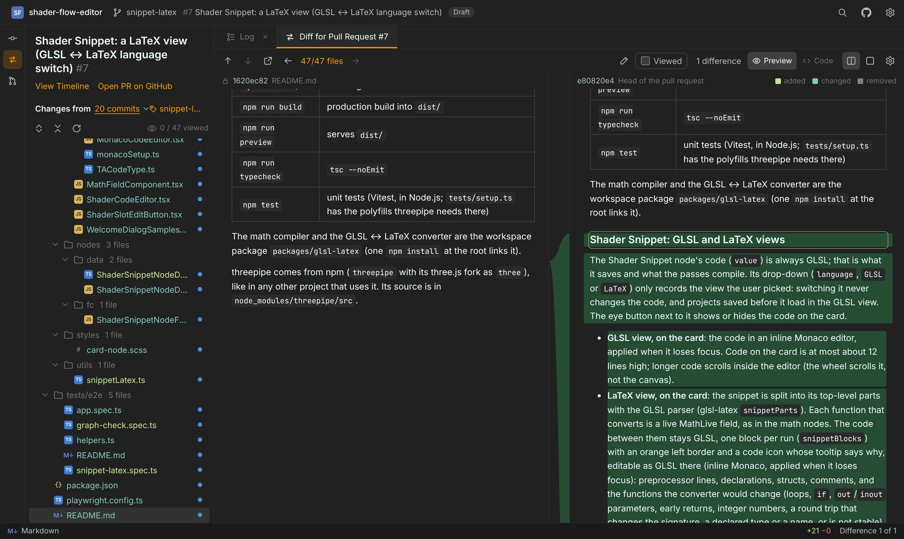
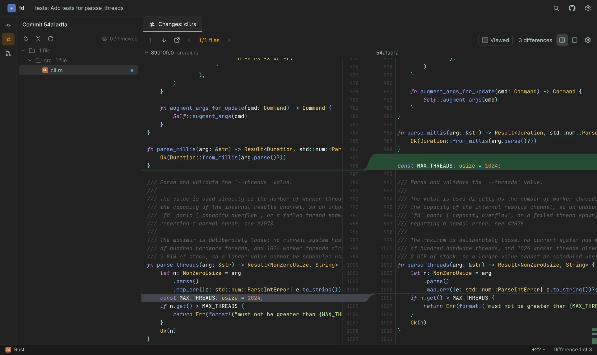
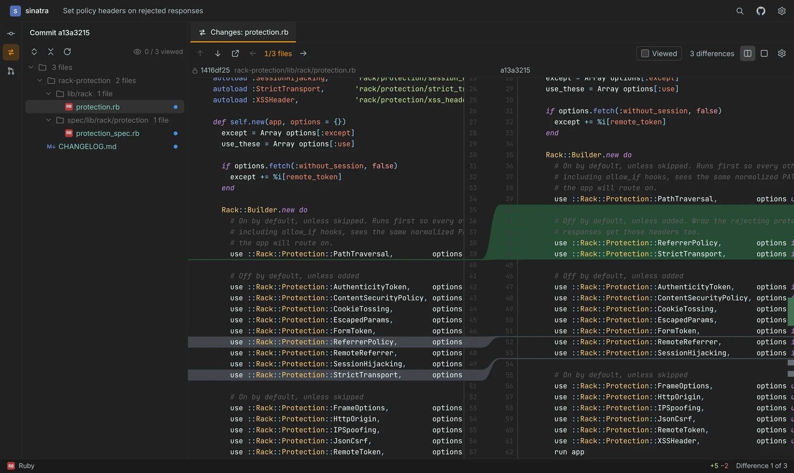

<p align="center"><picture><source media="(prefers-color-scheme: light)" srcset="icons/icon-light.svg"></picture></p>

<h1 align="center">jetdiff</h1>

<p align="center">Code changes in an IDE-style side-by-side diff, on any device, online or offline.</p>


jetdiff opens a GitHub pull request, a commit or a compare the way an IDE's diff shows it: a tree of the changed
files, and whole files side by side with curved connectors between the changes. It is a static web app with no build
step and no server of its own: it talks to the GitHub API from the browser.

## Features

- **Side-by-side diff** of whole files, with connectors between matching changes, synced scrolling, word-level
  highlighting and line numbers of both sides in the gutter. A unified view is one click away (and the default on a
  phone).
- **Changed-files tree** grouped by directory, with Viewed checkboxes that sync with GitHub's own when signed in.
- **Commits**: a log with a graph line; select a commit or a range to see only its changes.
- **Timeline**: the description, comments and reviews with their inline threads, rendered as Markdown.
- **Markdown preview** for `.md` files, with the changed words highlighted and the two versions kept side by side.
- **Quick edits**: edit the PR's files in place and commit them to its branch, with Amend and Undo.
- **Search Everywhere** (double Shift) for files, actions, settings, commits and pull requests.
- **Offline**: an installable app; download a repository's open pull requests and read them with no network.
- **Themes**: the Material Theme UI variants (Darker, Oceanic, Palenight, Lighter and more).

## Screenshots

| | |
| --- | --- |
|  Markdown preview |  Timeline |
|  GLSL (threepipe) |  TSX (shader-flow-editor) |
|  Rust ([fd](https://github.com/sharkdp/fd)) |  Go ([glow](https://github.com/charmbracelet/glow)) |
|  Python ([click](https://github.com/pallets/click)) |  C++ ([fmt](https://github.com/fmtlib/fmt)) |
|  Ruby ([Sinatra](https://github.com/sinatra/sinatra)) |  TypeScript ([VS Code](https://github.com/microsoft/vscode)) |
|  Lua ([lazy.nvim](https://github.com/folke/lazy.nvim)) |  Material Lighter theme |

<p align="center"></p>

## Use

Open `?pr=owner/repo/123`, or paste a pull request, commit or compare URL on the start page. Links keep their place:

| URL | Shows |
| --- | --- |
| `?pr=owner/repo/123` | a pull request |
| `?pr=owner/repo/123&file=src/a.ts` | a pull request, at a file |
| `?pr=owner/repo/123&commit=<sha>` | one commit of a pull request (`<sha1>..<sha2>` for a range) |
| `jetdiff.com/owner/repo/pull/123` | a GitHub link with `github.com` replaced: pull requests, commits and compares |

Keys: F7 and Shift+F7 move between differences, Alt+→ and Alt+← between files, V marks a file viewed, double Shift
opens Search Everywhere, and Ctrl/⌘ with + − 0 sizes the editor font.

### GitHub access

Public repositories work without signing in (GitHub allows 60 requests an hour then). For private repositories, a
higher limit and commits, either **Sign in with GitHub** (on jetdiff.com: it sees the repositories where the jetdiff
app is installed, and its token renews itself), or paste a token in the settings (the gear in the title bar): a fine-grained token with *Contents:
read* and *Pull requests: read and write* (write is only for Viewed), and *Contents: read and write* to commit edits;
or a classic token with `repo`. The token stays in the browser's storage and is sent only to `api.github.com`.

### Offline

Once loaded, the app opens with no network, and every pull request opened before shows from the saved copy. To get a
whole repository ready, use *Download for offline* (settings → Offline): it saves each open pull request with its
commits, file contents and conversation. Edits and Viewed marks made offline stay on the device. Saved data belongs
to the address the app was opened from.

### Snapshots and offline packs

A snapshot is a set of recorded GitHub responses, for trying the app without a token or sharing a read-only copy:

```sh
npm start
npm run record -- http://localhost:3000/ owner/repo/123 demo     # into snap/demo/
```

Then open `http://localhost:3000/?snap=demo&pr=owner/repo/123`. With `--repos owner/a,owner/b` instead of one pull
request, the recorder saves every open pull request of those repositories, and `npm run pack -- snap/demo packs/`
turns that into offline packs (.zip) to import from the start page or by dropping them on the page. A snapshot or a
pack of a private repository contains its code.

## Develop

```sh
npm install
npm start        # http://localhost:3000/
npm test         # Playwright, against a recorded pull request in tests/fixture
```

AGENTS.md describes the layout and the conventions. `js/themes.js` is generated from
[Material Theme UI Lite](https://github.com/AtomMaterialUI/material-theme-ui-lite):

```sh
git clone --depth 1 https://github.com/AtomMaterialUI/material-theme-ui-lite /tmp/mtui
npm run themes -- /tmp/mtui
```

## Deploy

[jetdiff.com](https://jetdiff.com) is a Cloudflare Worker with static assets (`wrangler.jsonc`, `worker/index.js`):
`npm run build` copies the files the site serves into `dist/`, and `npm run deploy` builds and deploys them with
wrangler. GitHub Actions deploys `main` after the tests pass (`.github/workflows/ci.yml`), with the repository
secrets `CLOUDFLARE_API_TOKEN` and `CLOUDFLARE_ACCOUNT_ID`, and `APP_CLIENT_SECRET` for the GitHub App's client secret. The Worker runs first on each request for request logs, the `www` redirect and a few security headers.
Any static host works too: serve the files listed in `tools/build.mjs`, with `404.html` for missing paths.

Sign in with GitHub needs the Worker and a GitHub App (`worker/auth.js`): create the app with the callback URL
`https://<your domain>/auth/callback`, *Expire user authorization tokens* on, no webhook, and the repository
permissions *Contents: read and write*, *Pull requests: read and write* and *Metadata: read*. Its client ID and URL name
go in `wrangler.jsonc` (`GITHUB_CLIENT_ID`, `GITHUB_APP_SLUG`; jetdiff.com uses
[jetdiff-com](https://github.com/apps/jetdiff-com)), and its client secret in the Worker's secret `GITHUB_CLIENT_SECRET`.
Without them the site offers token pasting only.

## License

MIT, see LICENSE. The theme colors come from Material Theme UI Lite (MIT), see NOTICE.
